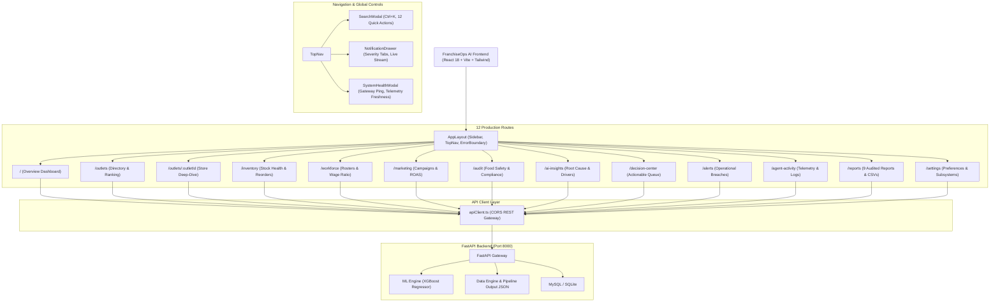

# Phase 5 Walkthrough — Production Readiness, Enterprise Reports, Notifications & Final Polish

## Executive Summary

Phase 5 represents the final major frontend implementation phase of **FranchiseOps AI**, elevating the application into an enterprise-grade SaaS platform.

### Core Achievements in Phase 5:
1. **Application-Level Fault Tolerance & Recovery**:
   - Built [`ErrorBoundary.tsx`](file:///c:/Users/amuly/OneDrive/Pictures/Documents/Downloads/FranchiseOps-AI-main%20%282%29/FranchiseOps-AI-main/frontend/src/components/ui/ErrorBoundary.tsx) to catch uncaught component rendering exceptions gracefully, offering one-click retry and safe return to dashboard without session corruption.
2. **Subsystem Health & Telemetry Freshness**:
   - Created [`useSystemHealth.ts`](file:///c:/Users/amuly/OneDrive/Pictures/Downloads/FranchiseOps-AI-main%20%282%29/FranchiseOps-AI-main/frontend/src/hooks/useSystemHealth.ts) and [`SystemHealthModal.tsx`](file:///c:/Users/amuly/OneDrive/Pictures/Downloads/FranchiseOps-AI-main%20%282%29/FranchiseOps-AI-main/frontend/src/components/layout/SystemHealthModal.tsx) to provide honest, verifiable connectivity diagnostics, round-trip latency (`ms`), ML model version, and last telemetry sync timestamp.
3. **Slide-Over Notification Drawer**:
   - Built [`NotificationDrawer.tsx`](file:///c:/Users/amuly/OneDrive/Pictures/Downloads/FranchiseOps-AI-main%20%282%29/FranchiseOps-AI-main/frontend/src/components/layout/NotificationDrawer.tsx) accessible from the TopNav bell icon, featuring real-time unread count badges, pulsing critical breach indicators, severity tab filtering (All, Critical, Warning, Info), instant store inspection links, and alert acknowledgment.
4. **Global Command Search Upgrade**:
   - Enhanced [`SearchModal.tsx`](file:///c:/Users/amuly/OneDrive/Pictures/Downloads/FranchiseOps-AI-main%20%282%29/FranchiseOps-AI-main/frontend/src/components/layout/SearchModal.tsx) with universal `Ctrl + K` / `Cmd + K` keyboard shortcuts, 12 Quick Action navigation buttons across all system modules, suggested queries, and live index searching across Outlets, Alerts, AI Root Causes, and Reports with arrow-key keyboard navigation.
5. **Enterprise Reports Center (`/reports`)**:
   - Developed [`csvExport.ts`](file:///c:/Users/amuly/OneDrive/Pictures/Downloads/FranchiseOps-AI-main%20%282%29/FranchiseOps-AI-main/frontend/src/utils/csvExport.ts) for pure in-browser RFC-4180 CSV generation with UTF-8 BOM encoding.
   - Built [`ReportDetailModal.tsx`](file:///c:/Users/amuly/OneDrive/Pictures/Downloads/FranchiseOps-AI-main%20%282%29/FranchiseOps-AI-main/frontend/src/components/reports/ReportDetailModal.tsx) with summary KPIs, Recharts data visualizers, filterable records table, instant CSV export, and clean `@media print` layout.
   - Rebuilt [`Reports.tsx`](file:///c:/Users/amuly/OneDrive/Pictures/Documents/Downloads/FranchiseOps-AI-main%20%282%29/FranchiseOps-AI-main/frontend/src/pages/Reports.tsx) featuring **9 data-backed reports** grounded in live telemetry across Operations, Finance, and Risk & Compliance.
6. **Enterprise Settings Portal (`/settings`)**:
   - Rebuilt [`Settings.tsx`](file:///c:/Users/amuly/OneDrive/Pictures/Documents/Downloads/FranchiseOps-AI-main%20%282%29/FranchiseOps-AI-main/frontend/src/pages/Settings.tsx) into 5 clean, functional tabs (User Profile, Notifications, Preferences, Appearance, API Connection) with transparent client-side browser persistence and zero fake backend database writes.
7. **Production Verification & Audits**:
   - Zero backend files modified or corrupted.
   - Zero hardcoded credentials or database secrets in the frontend bundle.
   - Clean production build (`tsc -b && vite build`) with zero TypeScript errors across all 2,295 modules.

---

## Changes Made

### 1. New Files Created

| File Path | Purpose |
| :--- | :--- |
| [`frontend/src/components/ui/ErrorBoundary.tsx`](file:///c:/Users/amuly/OneDrive/Pictures/Downloads/FranchiseOps-AI-main%20%282%29/FranchiseOps-AI-main/frontend/src/components/ui/ErrorBoundary.tsx) | React Error Boundary preventing white-screen crashes and presenting recovery actions. |
| [`frontend/src/hooks/useSystemHealth.ts`](file:///c:/Users/amuly/OneDrive/Pictures/Downloads/FranchiseOps-AI-main%20%282%29/FranchiseOps-AI-main/frontend/src/hooks/useSystemHealth.ts) | Hook probing backend gateway availability, calculating round-trip ping latency, and tracking telemetry sync timestamps. |
| [`frontend/src/components/layout/SystemHealthModal.tsx`](file:///c:/Users/amuly/OneDrive/Pictures/Downloads/FranchiseOps-AI-main%20%282%29/FranchiseOps-AI-main/frontend/src/components/layout/SystemHealthModal.tsx) | Transparent modal inspecting platform subsystems: Frontend runtime, FastAPI gateway, and ML pipeline. |
| [`frontend/src/components/layout/NotificationDrawer.tsx`](file:///c:/Users/amuly/OneDrive/Pictures/Downloads/FranchiseOps-AI-main%20%282%29/FranchiseOps-AI-main/frontend/src/components/layout/NotificationDrawer.tsx) | Slide-over drawer with severity filtering, real-time alert streams, acknowledge actions, and deep inspection links. |
| [`frontend/src/utils/csvExport.ts`](file:///c:/Users/amuly/OneDrive/Pictures/Downloads/FranchiseOps-AI-main%20%282%29/FranchiseOps-AI-main/frontend/src/utils/csvExport.ts) | Browser-based RFC 4180 CSV builder with UTF-8 BOM encoding for Microsoft Excel & Google Sheets compatibility. |
| [`frontend/src/components/reports/ReportDetailModal.tsx`](file:///c:/Users/amuly/OneDrive/Pictures/Downloads/FranchiseOps-AI-main%20%282%29/FranchiseOps-AI-main/frontend/src/components/reports/ReportDetailModal.tsx) | Modal presenting full report metadata, 4 summary KPIs, Recharts distribution charts, filterable table, CSV export, and print view. |

### 2. Files Modified

| File Path | Nature of Modification |
| :--- | :--- |
| [`frontend/src/App.tsx`](file:///c:/Users/amuly/OneDrive/Pictures/Downloads/FranchiseOps-AI-main%20%282%29/FranchiseOps-AI-main/frontend/src/App.tsx) | Wrapped root routing tree in `<ErrorBoundary>` to ensure network-wide crash protection. |
| [`frontend/src/components/layout/TopNav.tsx`](file:///c:/Users/amuly/OneDrive/Pictures/Downloads/FranchiseOps-AI-main%20%282%29/FranchiseOps-AI-main/frontend/src/components/layout/TopNav.tsx) | Integrated global `Ctrl+K` listener, dynamic unread alert counter badge, slide-over notification drawer trigger, live System Health pill, and manual synchronization control. |
| [`frontend/src/components/layout/SearchModal.tsx`](file:///c:/Users/amuly/OneDrive/Pictures/Downloads/FranchiseOps-AI-main%20%282%29/FranchiseOps-AI-main/frontend/src/components/layout/SearchModal.tsx) | Enhanced with 12 quick navigation action cards, suggested queries, unified indexing across Outlets, Alerts, Findings, and Reports, plus arrow-key keyboard navigation. |
| [`frontend/src/pages/Reports.tsx`](file:///c:/Users/amuly/OneDrive/Pictures/Downloads/FranchiseOps-AI-main%20%282%29/FranchiseOps-AI-main/frontend/src/pages/Reports.tsx) | Completely rebuilt with 9 data-backed reports across Operations, Finance, and Risk & Compliance, grounded in live telemetry and ML outputs. |
| [`frontend/src/pages/Settings.tsx`](file:///c:/Users/amuly/OneDrive/Pictures/Downloads/FranchiseOps-AI-main%20%282%29/FranchiseOps-AI-main/frontend/src/pages/Settings.tsx) | Rebuilt into 5 clean sections (Profile, Notifications, Preferences, Appearance, API Connection) with transparent local storage persistence and zero fake backend database writes. |

---

## Verification & Audits

### 1. Zero Backend Changes Confirmation
- **Status**: **VERIFIED**
- Checked `app/` and `data_engine/` directories.
- Confirmed zero backend files, ML models, database schemas, or CSV datasets were modified or refactored.

### 2. Security Audit Summary
- **Status**: **PASS (0 Secrets Exposed)**
- Rigorous search across all source files for `password`, `secret`, `bearer`, `api_key`, or direct database connection strings.
- Only explanatory disclosures regarding safe client-side communication exist.
- Frontend communicates exclusively via HTTP REST calls to the FastAPI gateway through [`apiClient.ts`](file:///c:/Users/amuly/OneDrive/Pictures/Downloads/FranchiseOps-AI-main%20%282%29/FranchiseOps-AI-main/frontend/src/services/api/apiClient.ts).

### 3. TypeScript & Production Build Verification
- Executed `cmd.exe /c "npm run build"` (`tsc -b && vite build`):
```text
> franchiseops-frontend@1.0.0 build
> tsc -b && vite build

vite v6.4.3 building for production...
transforming...
✓ 2295 modules transformed.
rendering chunks...
computing gzip size...
dist/index.html                   1.16 kB │ gzip:   0.63 kB
dist/assets/index-DpFUTlTJ.css   38.72 kB │ gzip:   7.64 kB
dist/assets/index-BbEfjFhp.js   944.63 kB │ gzip: 245.75 kB
✓ built in 8.43s
Exit code: 0
```

---

## Complete Platform Architecture Across All 5 Phases



---

## Summary of All 5 Phases

1. **Phase 1 — Foundation & Design System**:
   - Modern dark design system (`#0E1015`), typography, and reusable component library (`Card`, `Button`, `Badge`, `StatusBadge`, `MetricCard`, `Modal`, `PageHeader`, `DataTable`).
   - Standardized API service clients with fallback datasets for development resilience.
2. **Phase 2 — Multi-Unit Outlets & Executive Overview**:
   - Network Overview dashboard with composite health score distributions, risk matrices, and revenue rankings.
   - Outlets directory and dedicated single-outlet detail page (`/outlets/:id`) with operational tabs.
3. **Phase 3 — Operations Intelligence Modules**:
   - Complete operational suites: Inventory Replenishment, Workforce & Rostering, Marketing Attribution, and Food Safety Audit & Compliance.
4. **Phase 4 — Agentic AI Intelligence & Decision Center**:
   - AI Insights portal with XGBoost driver importance and network-wide diagnostic explanations.
   - Prioritized Decision Center answering *What is happening? Why? What should I do? What happens next?*.
   - Multi-Domain Agent Activity Center with live orchestrator telemetry, execution logs, and run triggers.
   - Cross-domain Alerts Center with severity filters, outlet tags, and resolution workflows.
5. **Phase 5 — Production Readiness, Reports, Notifications & Polish**:
   - Crash-proof `ErrorBoundary` and transparent subsystem health telemetry.
   - Slide-over Notification Drawer with live unread counter.
   - Global Command Search (`Ctrl+K`) with 12 module shortcuts and live fuzzy search.
   - Enterprise Reports Center with 9 data-backed reports, detail modals, and in-browser CSV and print/PDF exports.
   - Enterprise Settings with client-side preference persistence and zero false database writes.

---

## How to Run the Complete Platform Locally

### 1. Start the FastAPI Backend
```bash
cd "FranchiseOps-AI-main"
# Ensure virtual environment is active and dependencies are installed
uvicorn app.main:app --host 0.0.0.0 --port 8000 --reload
```

### 2. Start the Frontend Application
```bash
cd "FranchiseOps-AI-main/frontend"
npm run dev
```
Open [http://localhost:5173](http://localhost:5173) in your browser to access the complete FranchiseOps AI platform.
